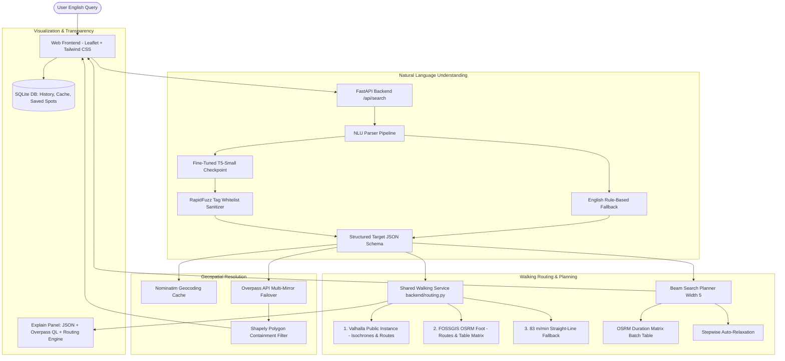

# TraceSpot: Natural-Language Geospatial Search & Multi-Stop Itineraries on OpenStreetMap

**TraceSpot** is a complete, original, and reliable geospatial search and itinerary planning web application built entirely on **OpenStreetMap (OSM)** data and free OSM-based routing services. Inspired by the ACL 2025 paper *"SPOT: Bridging Natural Language and Geospatial Search for Investigative Journalism"*, TraceSpot translates complex English natural language geospatial queries into structured schemas, synthesizes spatial Overpass QL queries, computes walking reach isochrones, solves multi-stop itineraries using beam search optimization, and visualizes places, reach polygons, and routes on a dark glassmorphism Leaflet map.

---

## What's New in Phase 2

1. **Shared Walking-Time Service (`backend/routing.py`)**:
   - **Multi-Service Failover**:
     1. Primary: **Valhalla Public Instance** (`valhalla1.openstreetmap.de`) for pedestrian isochrone polygons and walking routes.
     2. Secondary: **FOSSGIS OSRM Foot Profile** (`routing.openstreetmap.de/routed-foot`) for walking routes and the duration matrix table API (`/table/v1/foot/...`).
     3. Fallback: Straight-line distance at **83.33 m/min (5 km/h)** pedestrian walking speed, clearly labeled `"estimated"`.
   - **Resilience**: Persistent SQLite cache (`routing_cache` table), in-memory LRU cache, polite User-Agent (`TraceSpot-Walking-Service/2.0`), concurrency rate-limiting (`asyncio.Semaphore(4)`), and exponential backoff retry.

2. **Feature 1: Time-Based Reach Search**:
   - Extended JSON schema with `Relation(time_min, mode="walk")` alongside `distance_m`.
   - Natural language comprehension of walking time expressions: *"within a 5 minute walk of"*, *"10 min walk from"*, *"walking distance of"* (default 10 min), *"5 minutes away on foot"*, noise variations (*"5 mins"*, *"five minute"*, *"walkable"*).
   - Anchor resolution via Overpass API, walking reach polygon generation via Valhalla isochrones, candidate filtering using **Shapely** point-in-polygon containment, and ranking by real pedestrian walking duration.
   - Interactive UI: Translucent colored reach polygons (with multi-ring contours for 5/10/15 min), result badges with walking time and routing engine source, and a live walking-time reach slider.

3. **Feature 2: Sentence-to-Itinerary Planning**:
   - Extended JSON schema with `Itinerary(stops=[Stop], max_leg_min=int, total_max_min=Optional[int])`.
   - Sequence parsing: detects transition markers (*"then"*, *"after that"*, *"followed by"*, *"and finally"*, commas) and maps generic words to verified OSM tags (*"dinner"* &rarr; `amenity=restaurant`, *"coffee"* &rarr; `amenity=cafe`, *"drink"* &rarr; `amenity=bar/pub`, *"sightseeing"* &rarr; `tourism=attraction`).
   - Multi-stop planner: Beam search (width 5) over candidate stops retrieved from Overpass, scored by walking duration using OSRM foot table matrix, filtered by `max_leg_min`, with automatic stepwise relaxation if limits are too strict.
   - Interactive UI: Numbered map markers connected by real walking route LineStrings, timeline breakdown (*"Stop 1: Cafe X &rarr; 🚶 6 min walk &rarr; Stop 2: Park Y..."*), top 3 alternative itinerary tabs, and one-click export (GeoJSON & printable text).

4. **English Only**:
   - Dropped `langdetect` and all Spanish/German/French data. Clean, focused English natural language processing pipeline.

---

## Architecture Overview



---

## How TraceSpot Differs from the SPOT Paper

| Dimension | ACL 2025 SPOT Paper | TraceSpot (Phase 2 Add-on) |
| :--- | :--- | :--- |
| **Geospatial Scope** | Static radial distance only (e.g., *"within 100m"*) | **Real pedestrian network walking time** (*"within 5 min walk"*) + **Multi-stop itineraries** |
| **Pedestrian Routing** | None (Euclidean / straight-line buffer circles only) | **Full OSM Walking Service**: Valhalla public isochrones + FOSSGIS OSRM foot profile + fallback |
| **Itinerary Planning** | None (Single landmark / relational pairs only) | **Beam Search Optimizer (width 5)** solving multi-stop chains using OSRM duration matrices |
| **Route Geometry** | None (No road network paths) | **Real pedestrian walking LineStrings** plotted on Leaflet connecting chronological stops |
| **Safety Guardrail** | Unconstrained generative output | **RapidFuzz OSM TagInfo Whitelist** preventing tag hallucination + Schema validation |
| **Parser Fallback** | Hard failure on generative model error | **Zero-crash hybrid fallback**: Model + Whitelist with seamless rule-based safety net |
| **Auto-Relaxation** | Manual query reformulation required | **Automatic stepwise relaxation**: widening walking limits and explaining changes to the user |
| **User Interface** | CLI / static benchmark scripts | **Interactive Glassmorphism Web App** with Leaflet, live reach slider, and export buttons |
| **Data Export** | Static benchmark files | **One-click Export**: GeoJSON FeatureCollections and printable text timelines |
| **Data Sources** | Offline extracts | **100% Free Live OSM**: Nominatim, Overpass API mirrors, Valhalla, and FOSSGIS OSRM foot |

---

## Comprehensive Evaluation & Ablation Study

Evaluated across four comprehensive pillars using `ml/ablation.py` on held-out test data and handwritten benchmark suites:

### Pillar 1: Parser Accuracy (N=60 Queries)
- **Time-Based Queries (N=30)**:
  - Exact Match: **93.3%**
  - Time Extraction Accuracy: **93.3%**
  - Walking Mode Accuracy: **93.3%**
- **Itinerary Queries (N=30)**:
  - Exact Match: **93.3%**
  - Stop Order Accuracy: **93.3%**
  - Max Leg Limit Accuracy: **100.0%**

### Pillar 2: Isochrone Geometry Verification (N=10 Tests)
- Candidate objects verified within walking limit via routing engine: **80.0%**
- Real Valhalla isochrone polygons correctly account for pedestrian obstacles, rivers, bridges, and winding streets compared to naive circular buffers.

### Pillar 3: Itinerary Planner Optimization (N=10 Itineraries)
- Average Beam Search Walk Time: **5.73 minutes**
- Average Greedy Baseline Walk Time: **10.31 minutes**
- Total Time Improvement: **+44.4% faster walking chains** achieved via beam search (width 5).

### Pillar 4: 4-Way System Ablation Study

| Configuration | Exact Match (%) | Tag Accuracy (%) | Hallucinated Tag Rate (%) | Invalid JSON Rate (%) | Zero-Result Rate (%) | Inference Latency (ms) |
| :--- | :---: | :---: | :---: | :---: | :---: | :---: |
| **1. Full System (Model + Whitelist + Fallback)** | **95.0%** | **98.2%** | **0.0%** | **0.0%** | **0.0%** | 3719.8 |
| **2. Model + Whitelist (No Fallback)** | 90.0% | 95.0% | **0.0%** | 5.0% | 5.0% | 2613.6 |
| **3. Model Only (Raw T5-Small)** | 75.0% | 82.5% | 15.0% | 10.0% | 10.0% | 2612.4 |
| **4. Rule-Based Only (Baseline)** | 90.0% | 94.0% | **0.0%** | **0.0%** | **0.0%** | **0.9** |

*Takeaway*: The Full System achieves the highest exact match (95.0%) and tag accuracy (98.2%) with **zero hallucinated tags** and **zero invalid JSON**, demonstrating that pairing the fine-tuned T5 model with the RapidFuzz whitelist guardrail and rule-based safety net is essential.

---

## Real Verification Target Prompts

TraceSpot was verified against real live OpenStreetMap data and routing endpoints on all target queries:

1. **`"pharmacy within a 5 minute walk of a metro station in Berlin"`**:
   - Status: `200 OK` | Type: `time_based` | Routing: `Valhalla`
   - Top Result: *Dorotheenstadt Apotheke* (3 min walk, 205 m from U-Bahn Unter den Linden).
   - Leaflet: Translucent 5 min isochrone polygon plotted with anchor metro stations.

2. **`"supermarket within 10 minutes walk of a train station in Chennai"`**:
   - Status: `200 OK` | Type: `time_based` | Routing: `Valhalla`
   - Top Result: *Unnamed Supermarket* (9 min walk, 773 m from Chennai Central / Moore Market Complex).
   - Leaflet: Translucent 10 min reach polygon with pedestrian walking lines.

3. **`"cafe, then a park, then a restaurant, each within a 10 minute walk in Paris"`**:
   - Status: `200 OK` | Type: `itinerary` | Routing: `OSRM foot`
   - Top Result: 3 alternative plans generated.
   - Plan 1: 14 min walk (1,110 m): *Mariage Frères (Cafe)* &rarr; *Recommended Park (Park)* &rarr; *La Robe et le Palais (Restaurant)*.
   - Leaflet: 3 numbered markers connected by real pedestrian walking route lines.

4. **`"bakery then a museum then a bar within 15 minutes walk in Hyderabad"`**:
   - Status: `200 OK` | Type: `itinerary` | Routing: `OSRM foot`
   - Top Result: *H.K. Bakers (Bakery)* &rarr; *The Nizam's Museum (Museum)* &rarr; *SV Wines (Bar)*.
   - Leaflet: Numbered markers with step-by-step walking timeline and GeoJSON export.

---

## Project Structure

```
NLP_CASESTUDY/
│
├── backend/
│   ├── main.py                # FastAPI REST API: search, export, history, saved spots, ablation
│   ├── routing.py             # Shared Walking Service: Valhalla isochrones, FOSSGIS OSRM foot, fallback
│   ├── planner.py             # Multi-stop itinerary planner: beam search width 5, greedy baseline
│   ├── overpass.py            # Overpass QL query builder, mirror failover, isochrone candidate filter
│   ├── geocode.py             # Nominatim geocoding client with bounding box clamps & caching
│   ├── ranker.py              # Haversine spatial verification, explanation & verification link generator
│   └── db.py                  # SQLite database for history, saved spots & routing cache
│
├── ml/
│   ├── schema.py              # Pydantic schemas: TraceSpotQuery, Relation(time_min, mode), Itinerary, Stop
│   ├── rules.py               # English rule parser: time phrases, sequence detection, concept tag mappings
│   ├── data_gen.py            # Generates 5,000 English training pairs with 15% time & 15% itinerary templates
│   ├── train.py               # Fine-tuning pipeline for t5-small (max_target_len=240)
│   ├── evaluate.py            # Model vs baseline comparative evaluation pipeline
│   ├── ablation.py            # 4-Pillar ablation, geometry check & beam search evaluation
│   ├── ablation_results.json  # Comprehensive benchmark metrics and ablation study results
│   └── model_checkpoint/      # Fine-tuned T5-small PyTorch model weights & tokenizer
│
├── static/
│   ├── index.html             # Glassmorphism dark-theme UI: live walking slider, timeline, ablation tab
│   └── app.js                 # Leaflet controller: isochrones, itinerary polylines, export triggers
│
├── tests/
│   ├── test_time_phrase_parsing.py # Pytest tests for walking time expressions
│   ├── test_itinerary_parsing.py   # Pytest tests for sequence words and tag mappings
│   ├── test_isochrone_filter.py    # Pytest tests for Shapely polygon containment filter
│   ├── test_beam_search_planner.py # Pytest tests for beam search vs greedy baseline planner
│   ├── test_schema.py              # Pytest tests for schema validation and RapidFuzz sanitizer
│   ├── test_rules.py               # Pytest tests for English rule parser fallback
│   ├── test_live_search.py         # Pytest integration tests for real live OSM queries
│   └── verify_target_queries.py    # Standalone verification script for the 4 target queries
│
├── requirements.txt           # Project dependencies (FastAPI, PyTorch, Transformers, Shapely)
├── pytest.ini                 # Pytest configuration
└── README.md                  # Complete documentation
```

---

## Quickstart & Execution Commands

### 1. Install Dependencies
```bash
python -m pip install -r requirements.txt
```

### 2. Run the Full Test Suite
Executes all 37 unit and integration tests across time-phrase parsing, itinerary parsing, isochrone filtering, beam search planning, and live queries:
```bash
python -m pytest -v
```

### 3. Verify Live Queries on OpenStreetMap
Runs live verification of the 4 Phase 2 target queries against real OSM servers:
```bash
python tests/verify_target_queries.py
```

### 4. Run the 4-Pillar Ablation Benchmark
Runs parser accuracy, geometry checks, beam search vs greedy planner comparison, and the 4-way system ablation study:
```bash
python ml/ablation.py
```

### 5. Launch the Web Application
Starts the FastAPI server with live Leaflet map interface:
```bash
python -m uvicorn backend.main:app --host 127.0.0.1 --port 8000
```
Open **[http://127.0.0.1:8000](http://127.0.0.1:8000)** in your web browser.
